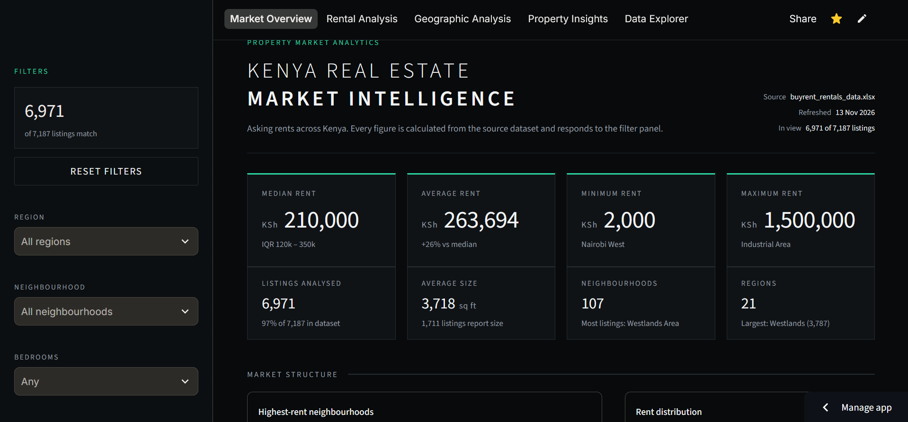

# Kenya Rental Market Intelligence

An interactive dashboard for exploring asking rents across Kenya. The data is collected from property listings with a Python scraper, cleaned with pandas and presented in a multi-page Streamlit app with Plotly charts.

**Live app:** https://kenyarentalmarketdashboard.streamlit.app/



## What it does

- **Market Overview:** median, average, minimum and maximum rent, listing counts, average size, and how many neighbourhoods and regions are covered.
- **Rental Analysis:** rent by neighbourhood (average and median), rent and size distributions, bedroom comparisons, size-versus-rent scatter with a trend line, and rent ranges per neighbourhood.
- **Geographic Analysis:** regional summary, listing concentration treemap, neighbourhood ranking, a neighbourhood by bedroom heatmap, and a region-to-region price comparison.
- **Property Insights:** facts computed from the filtered data (highest-rent bedroom count, cheapest and most expensive neighbourhoods, size and rent correlation, widest price spread).
- **Data Explorer:** searchable, sortable listings table with CSV export.

Everything is calculated from the dataset and responds to the sidebar filters (region, neighbourhood, bedrooms, category, rent range, size range).

## How it works

```
scraper.py  ->  buyrent_rentals_data.xlsx  ->  data.py (clean + flag outliers)  ->  Streamlit pages
```

### Data cleaning decisions

- Rows with a missing or non-positive rent are removed; rows with a missing size, bedroom count or location are kept.
- Image and thumbnail suffixes are stripped from text fields.
- Outliers are flagged statistically (rent far from the median of listings with the same bedroom count, using a robust modified z-score on log rent) instead of a fixed price cap. Flagged rows are listed in the app and can be included or excluded from the sidebar.

## Run locally

```bash
pip install -r requirements.txt
streamlit run app.py
```

The app reads `buyrent_rentals_data.xlsx` from the project folder.

## Project structure

| File | Purpose |
| --- | --- |
| `app.py` | Entry point, sidebar filters, navigation |
| `views.py` | The five dashboard pages |
| `charts.py` | Plotly chart builders |
| `theme.py` | Colours, CSS and chart styling |
| `data.py` | Loading, cleaning, outlier flagging, filtering |
| `scraper.py` | Collects the listings data |
| `.streamlit/config.toml` | Dark theme settings |

## Limitations

- The dataset has no coordinates, so there is no map; locations are compared by name.
- These are asking prices from listings, not transaction prices.
- Property type is inferred from listing titles where the file has no type column.
- Figures reflect the date the data was last scraped.

## Tech

Python, pandas, Streamlit, Plotly.
